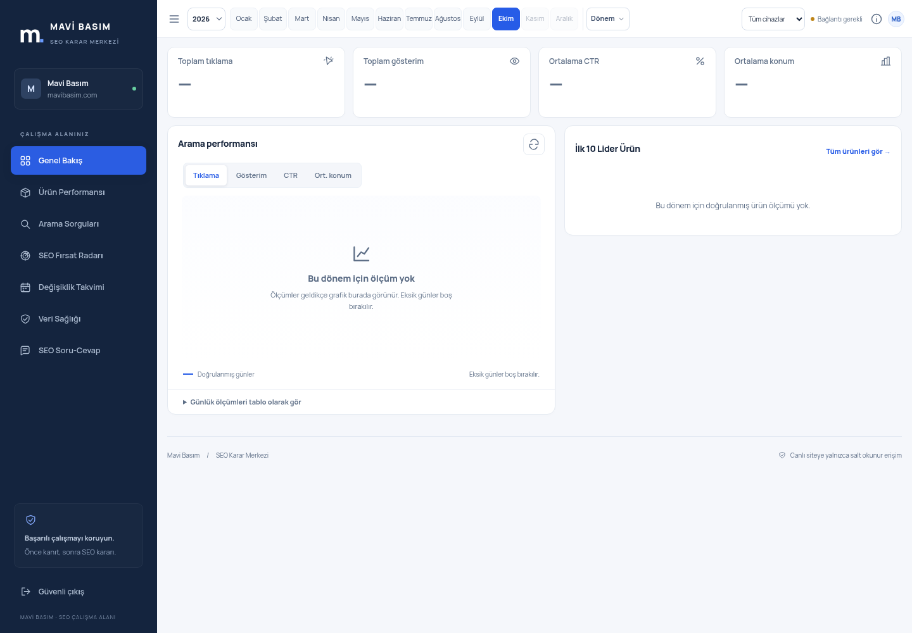
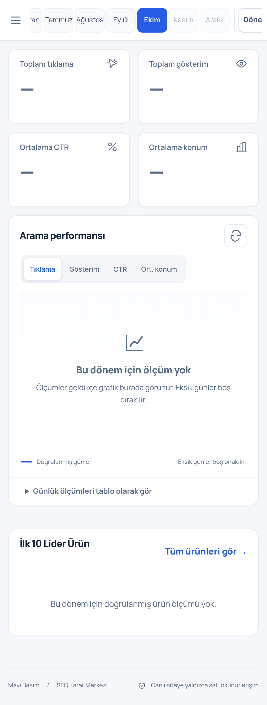

# Veri odaklı kompakt panel — 25 Ekim 2026

Başlangıç main `2717153`; dal `fix/compact-data-first-dashboard`. Mevcut lacivert menü, açık zemin, grafikler, tablolar ve gerçek API'ler korunur. Yeni SEO modülü veya veri hesaplama kuralı yoktur. Son commit `git log -1 --oneline`; uzak CI, yayın ve canlı sürüm kanıtları bu değişikliğin PR açıklaması ve kontrollü production workflow'unda izlenir.

## Gerçek yayın sonucu — 25 Ekim 2026, 15:51 Türkiye

- Uygulama kodu `cc1e87c`, PR **#19**, main **9dbcafa5d634b1b80d2a78f1fa08b2fc6df687a4**. PR CI **40194303362** ve main CI **40194492122** başarılı; 299 + 49 + 26 = **374 test** geçti.
- Mevcut Cloudflare Git otomatik yayını **15:45 Türkiye** tarihinde Worker **2f502c68-76ae-48a7-b87a-5b7e45bf62e4** sürümüne %100 trafik vermiştir. Gerçek canlı **12 statik dosyanın tamamının SHA-256 değeri main ile eşleşir**. Masaüstü/mobil canlı giriş kabulü, font/JS/taşma/axe, kompakt çubuk/başlıksız DOM ve oturumsuz performans/sorgu API'lerinin 401 koruması başarılıdır. Yerel yetkili tarayıcı düzeni ekran görüntüleri yukarıdadır; özel canlı yönetici oturumu kullanılmamıştır.
- **Kontrollü tam yayın kabulü tamamlanmadı.** Production workflow **40194725690**, yayımlama adımından önce güvenlik ön kontrolünde durdu. Bu koşu Worker/D1/Cron/secret değiştirmedi. Canlı Git otomatik sürümünde tam commit etiketi `null`; bu yüzden tam commit/sürüm kabulü de false kalır. Arayüz dosyalarının canlıda olması ile kontrollü yayının kabulü ayrı sonuçlardır.
- Salt okunur gerçek tanılama **40194908709**, **15:50 Türkiye**: D1 günlük okuma **4.075.790**, yazma **57.055**. Yayın güvenlik eşiği **4.000.000 okuma** aşıldı; Cloudflare Free sert sınırı **5.000.000 okumadır**. Tam ücretsiz kota bitmiş veya ücret başlamış denmez. Eşik düşürülmedi/gevşetilmedi, sayaç sıfırlanmadı; yeni ücretli kaynak açılmadı.
- Aynı tanılama mevcut OAuth binding'leri, D1, **dakikalı Cron**, otomasyon/tarama bayrakları, günlük **60.000** senkron bütçesi ve **29 ürün / 521 CSV / 9.075 satırı** doğrular. Yeni Google senkronu/site taraması başlatılmaz.

**Bir sonraki somut adım:** **26 Ekim 2026 03:00 Türkiye / 00:00 UTC sonrasında**, gerçek güncel D1 kullanımını ve mevcut Worker UUID'sini tekrar oku. Güvenli ön kontrol geçiyorsa mevcut main ve başarılı CI için production workflow'u o gerçek UUID ile çalıştır; tam commit etiketi, HTTP sürümü, binding/kaynak koruması ve canlı dosya eşleşmesini yeniden doğrula. Kota yenilenmeden veya kontrol geçmeden yeniden yayını zorlamayın. Kendiliğinden yeniden çalıştırma garantisi verilmez; kullanıcının yeni token/ücretli plan/onay işlemi gerekmiyor.

Bu yayın durum belgesi ayrı `docs/compact-release-checkpoint` dalında saklanır. Mevcut main'e bağlı Git otomatik yayını, kota güvenlik kapısı engelinden sonra tekrar tetiklenmemesi için bu belge dalı henüz main'e birleştirilmez. Bu, uygulama kodunun main'e kaydedilmediği anlamına gelmez; kod PR #19 ile zaten main'dedir.

## Çalışan düzen

- Büyük sayfa başlığı/açıklaması, tekrar eden SEO KARAR MERKEZİ metni, sekme karşılama/intro blokları ve sürekli yenile açıklaması HTML'den kaldırıldı. Erişilebilirlik için tek bir `sr-only` H1, seçili sekmenin gerçek adını taşır; main bu başlıkla etiketlidir. İşlevsel tablo/grafik/bölüm başlıkları korunur.
- **60 px tek satır üst araç çubuğu:** menü, yıl, Ocak–Aralık 12 ay, Dönem, cihaz, veri durumu, bilgi, MB. Aylar **44 px eşit genişlik / 2 px aralık / 36 px yükseklik** kullanır; seçili ay mavidir. 1280/1440/1920 px masaüstünde bütün aylar ve kontroller aynı satırda, kırpılmadan görünür. 1024 px dar pencere ve mobilde tek satır kendi içinde yatay kayar; menü düğmesi erişilebilir kalır. Sayfanın kendisinde yatay taşma yoktur. Mobilde yıl, dönem, cihaz, durum ve MB'nin kaydırmayla görünür sınırlar içinde erişilebilir olması ayrıca test edildi.
- Yıl/ay/dönem/cihazın mevcut tercih ve otomatik yükleme mantığı korunur. Dönem menüsü kaydırma alanının dışında sabit koordinatla açılır; kesilmez. Klavye, Escape ve dış tıklama çalışır. Gelecek aylar seçilemez.
- Genel Bakış doğrudan KPI ile başlar; grafik ve İlk 10 Lider Ürün onların altındadır. Kanıtlı öncelik yoksa boş öncelik şeridi gösterilmez. Ürün/sorgu filtreleri, radar kartları, takvim günü, kaynak kontrolleri ve soru alanı kendi sekmelerinde üstten başlar. Yedi çalışma alanının ilk işlevsel öğesi tarayıcıda 220 px'den yukarıda, KPI'lar 100 px'den yukarıda doğrulanır.
- **Tek mevcut yenile/indirme düğme grubu**, etkin çalışma alanının sağ üstüne taşınır. Aynı düğmeler çoğaltılmaz; API uçları ve indirme kapsamı değişmez. Yenile yalnız kayıtlı veriyi okur. Veri sağlığının bağımsız denetim düğmesi, bağlantı/otomasyon ayrıntılarında korunur.
- Veri kapsamı, tarih, son güncelleme ve kaynak açıklamaları durum/bilgi düğmesindeki mevcut erişilebilir pencerededir. Sorgu kapsamı ve radar sınırları açılır ayrıntılarda saklanır. Teknik SEO tespit/yayın tarihi ayrımı ve kanıtlar silinmez.
- **Gerçek hatalar görünürdür:** SEO analizine veya GSC sağlık kontrolüne erişilemezse kapalı bilgi penceresinin dışında `role=alert` hata alanı gösterilir. Ağ yenileme hatası görünür bildirim üretir ve önceki başarılı verinin kapsamını korur. Oturum kapanınca özel bilgi penceresi kapatılır, hata/kanıt ayrıntıları temizlenir.
- Eksik metrik `—` kalır. Gerçek ürün ölçümü yokken lider tablosu doldurulmaz veya boş listeye liderlik etiketi eklenmez. Kısmi ölçümlü sıralamada kapsam uyarısı korunur. GSC, Planner ve GA4 metrikleri birbirine eklenmez.

## Test ve güvenlik kanıtı

**374 başarılı test:** 299 Workers/D1, 49 Python ve 26 Chromium masaüstü/mobil. Tip kontrolü, paketleme, production dry-run, kaynak/secret/üretim ayarı denetimi ve npm audit 0 başarılı. Son başarısız veya atlanan test yok.

Tarayıcı testleri mevcut gerçek yerel API ile kaynaklar/giriş/boş veri/kanıt/sekme/dönem/cihaz/yenile/çıkış akışını çalıştırır. Grafikli ve liderli sınır durumları yalnız tarayıcı HTTP fixture'larıyla ayrı test edilir; örnek kayıt üretim D1'e yazılmaz. WCAG A/AA, açık menü erişilebilirliği, klavye/fokus, belge taşması, tek satır geometrisi, eşit ay genişlikleri, yedi sekmenin veri başlangıç konumu, görünür hata ve çıkışta özel ayrıntı temizliği kontrol edilir.

İlk tam tarayıcı koşusunda iki mobil dönem testi başarısızdı: menüyü görünür alana taşıyan otomatik kaydırma, menüyü koşulsuz kapatıyordu. Kaydırmada menünün koordinatları güncellenir; yalnız tetikleyici tamamen görünmez olduğunda kapanır. İki hata tekrar testi ve tam 26 testlik koşu başarılıdır. Testler gevşetilmedi; dönem/cihaz/API/tercih doğrulamaları korunur.

**Korunan dosya ve sistemler:** `src/`, migrations, Cloudflare yapılandırması/workflow'ları, paket bağımlılıkları, GSC OAuth, D1, Cron, günlük yazma bütçesi, site tarayıcısı, 29 ürün ve 521 özgün CSV değişmez. Tüm 521 dosya hash'i ve 9.075 kaynak satırı içe aktarım testlerinde denetlenir. Canlı mavibasim.com'a yazma/tarama başlatılmadı; ücretli hizmet yoktur.

Bu UI teslimi eksik geçmiş GSC günlerini veya tam aylık SEO raporu kabulünü tamamlamaz. Önceki gerçek salt okunur D1 hesap kabulü **40190507538** tarihli kanıttır; bu çalışmada backend aynı kaldığı için yeniden veri aktarımı veya gereksiz uzak veritabanı denetimi başlatılmaz. Özel üretim yönetici oturumu kullanılmaz veya aşılmaz. Canlı yayın, tam commit/Worker sürümü, aynı D1/auth binding'leri/kaynak sayıları, gerçek statik dosyaların SHA-256 eşleşmesi ve masaüstü/mobil giriş/oturumsuz API korumasıyla ayrıca doğrulanır.

## Ekran görüntüleri

Görüntüler Chromium'da mevcut uygulama ve **gerçek yerel API** ile çekildi. Yerel Google hesabı bağlı değildir; trafik ve liderler bilinçli olarak boştur. Bunlar gerçek üretim GSC performans sonucu veya sahte veri değildir. Sayfa geometrisi yukarıdaki otomatik kabul kontrolleriyle ayrıca ölçülür.

## Değişen uygulama dosyaları

`public/index.html`, `public/app.css`, `public/app.js`, `public/period.js`, `public/modules.js`. Testler: `tests/browser/usage.spec.ts`, `tests/browser/dashboard.spec.ts`. Belgeler: README.md, TODO.md, bu rapor ve iki ekran görüntüsü. Formatlama için geçici olarak sabitlenmiş ücretsiz Prettier 3.6.2 kullanıldı; bağımlılık/lock dosyası değiştirilmedi.
