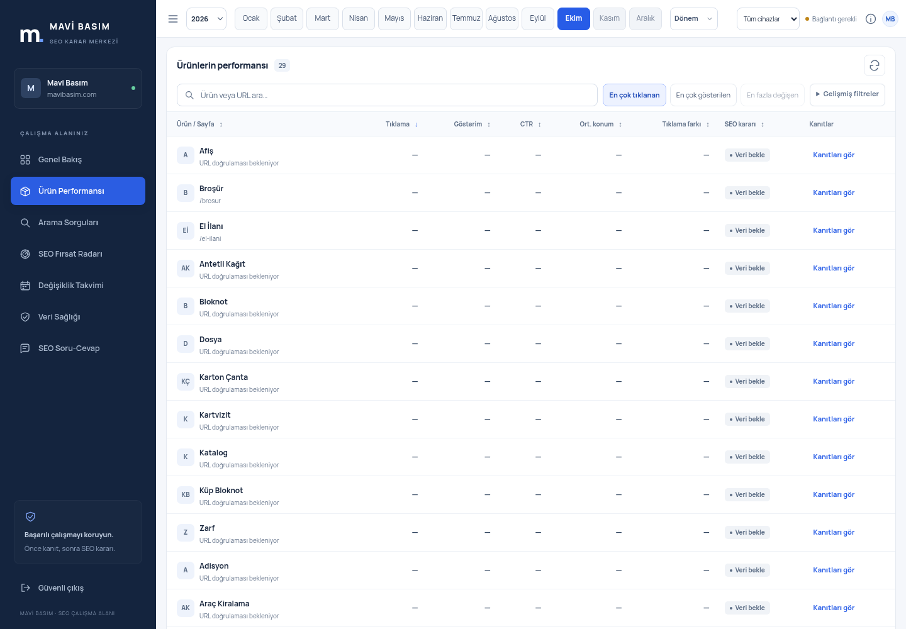
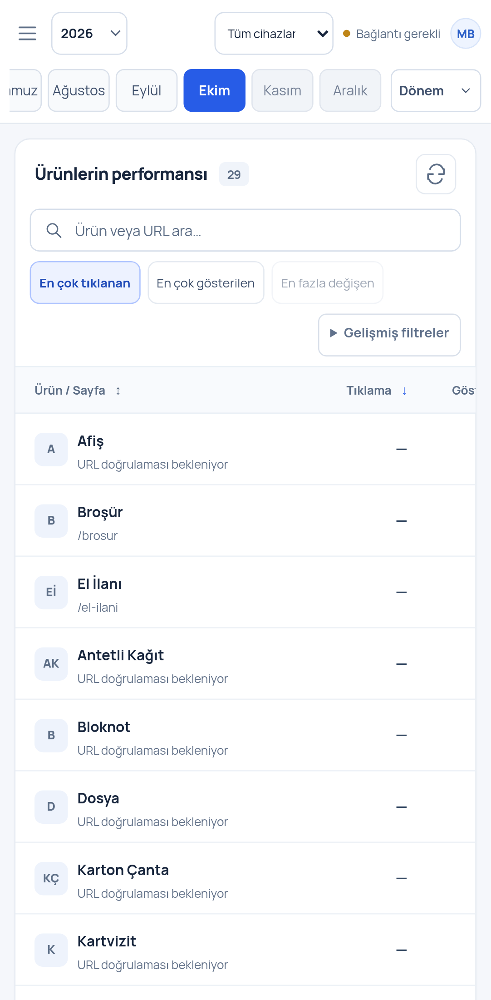
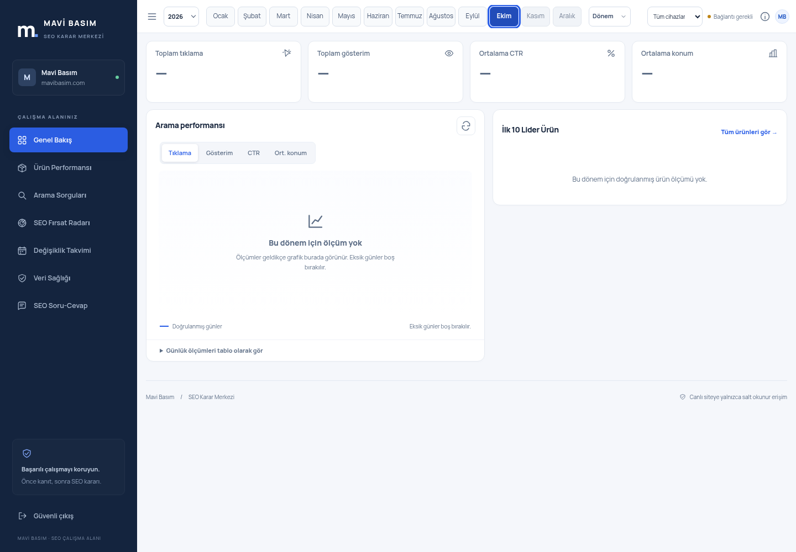

# Ay düğmeleri ve ürün tablosu yoğunluğu — 25 Ekim 2026

Dal `fix/month-states-and-table-density`; uygulama temeli main `9dbcafa`, önceki kota kontrol noktası `52eb12f` bu dala dahildir. Yeni SEO modülü yoktur; mevcut renkler, API, gerçek metrik hesapları ve veri yapısı korunur. Son commit git log'da; uzak CI bu dalın PR'ında izlenir.

## Çalışan düzeltmeler

- Normal aylar açık zemin/koyu yazı/1 px gri kenarlık; aralık **5 px**, daha dar masaüstünde **4 px**. Düğmeler **52 px**, dar masaüstünde **46 px** eşit genişliktedir; 10.5 px eski yazı yerine 11–11.5 px kullanılır. Yıl–Ocak ve Aralık–Dönem boşlukları 6–10 px'dir.
- Önceki `.month-strip button:hover:not(:disabled)` seçicisi, seçili hover kuralından daha güçlüydü; mavi zemini açıp beyaz yazının görünürlüğünü kaybettiriyordu. Yeni seçiciler button+aria-pressed ve tüm hover/focus/active durumlarını açıkça tanımlar: **color #FFFFFF, opacity 1**, mavi zemin. Disabled aylar gri zeminde okunabilir metin kullanır; iki kez soluklaştırılmaz. Odak çizgisi korunur.
- Yalnız **ayların alanı** yatay kayar. Cihaz, veri durumu, yıl/dönem ve MB sabit görünür kalır. 1280/1440/1920 px masaüstünde 12 ay birden görünür; 1024 px dar pencerede düğmeler ezilmeden kayar. Masaüstü/tablet üst çubuk 60 px'dir. 640 px ve altında telefonda yıl/cihaz/durum/MB üstte, aylar ve dönem ikinci kompakt satırda **104 px** kullanır; böylece sabit kontroller kesilmez. Ayrı bilgi simgesinin işlevi telefonda mevcut durum düğmesinden erişilir.
- Aynı yılda ay düğmeleri her veri yüklenişinde yeniden oluşturulmaz; seçili durum yerinde güncellenir. Hızlı seçimlerde DOM/fokus korunur. Yıl değişiminde 12 düğme yeniden kurulur; gelecek ay engeli ve mevcut tercihler korunur.
- Yalnız Ürün Performansı tablosunda satırlar **60 px**, başlık **40 px**; üst/alt hücre boşlukları 8 px, ürün adı/URL mesafesi 1 px, avatar 28 px. Sayılar kendi sütunlarında sağa, bütün hücreler dikey ortalanır. Uzun adın tam hali erişilebilir metin ve title ile korunur. Sorgu/kanıt tablolarının yoğunluğu değiştirilmez.
- Masaüstünde arama, sıralama ve gelişmiş filtre kompakt bir satırdadır. Açılır gelişmiş seçenekler tabloyu aşağı itmez. Dar ekranda doğal biçimde sarılır. Filtre–tablo başlığı arası en fazla 10 px; indirme/yenileme mevcut sağ üst konumunda kalır.

## Kabul ve testler

**382 test geçti:** 299 Workers/D1 + 49 Python + 34 Chromium masaüstü/mobil. Typecheck/build, production dry-run, tüm 521 CSV/hash/9.075 satır aktarım denetimi, secret/kaynak/üretim denetimi ve npm audit 0 başarılı. Son uygulama testi başarısız veya atlanmış değildir.

Yeni sekiz Chromium senaryosu normal/hover/seçili/klavye odağı/active/disabled durumlarını, seçili düğmenin gerçek RGB ve atalarının etkin opacity değerini, 4–6 px boşlukları, metnin düğmeye sığmasını, bütün sabit kontrollerin ekran sınırlarını, 320/360/393/768 ve 1280/1440/1920 px düzenlerini kontrol eder. Ürünlerde 29 satırın her biri 56–64 px, sekiz sütun, dikey/yatay hizalar, kısa başlık ve filtre arası ölçülür. Arama, sıralama, karar filtresi ve mevcut kanıt davranışı korunur. Ayrı tarayıcı HTTP fixture'ı 40/600/CTR/konum/eksik fark değerlerinin doğru sütunlarda kalmasını doğrular; fixture D1'e veya üretime yazılmaz. WCAG A/AA testleri başarılıdır.

İlk yeni koşuda bir masaüstü testi ayları kaydırırken düğümlerin yüklemeyle değiştirilmesini yakaladı. Aynı yılda düğümleri koruyan düzeltme ve tamamlanmış rapor kapsamını bekleyen testle tam 34 test, ardından biçimlendirme sonrası sekiz yeni sınır testi yeniden geçti.

## Üretim yayını durumu

**Bu düzeltme henüz canlıya yayımlanmadı; main'e birleştirilmedi.** Önceki main arayüzü çalışmaya devam eder. Mevcut Cloudflare Git otomatik yayını, bilinen güvenlik kapısını dolanmak için tetiklenmedi. Üretim ayarları, Cron ve bütçe değiştirilmedi.

Gerçek salt okunur tanılama **40199411351**, **25 Ekim 2026 16:50 Türkiye**: hesap genelinde D1 günlük okuma **5.039.419**, yazma **57.754**. Analytics gecikmeli olabilir. Mevcut kontrollü yayın kapısı **4.000.000** okuma sınırında durur; Free belgelenen sınırı 5.000.000'dir. Bu ölçümden yeni ücret veya plan etkinleştirildiği sonucu çıkarılmaz. Kaynaklar **29 ürün / 521 dosya / 9.075 satır**, Cron `* * * * *` korunmuştur. Yeni ağır Google/D1 analiz veya site taraması başlatılmadı. Üretim özel yönetici oturumu kullanılmadı.

**Kalan adım:** 26 Ekim 2026 **03:00 Türkiye / 00:00 UTC sonrasında** gerçek güncel kotayı ve Worker UUID'sini doğrula. Kapı geçiyorsa başarılı PR CI sonrası main'e birleştir; main CI ve mevcut production workflow ile yayımla. HTTP tam commit/Worker kimliği, binding/kaynak koruması, dosya hash'i ve canlı tarayıcı kabulünü tamamla. Yeni kullanıcı token'ı/onayı/ücretli plan gerekmiyor. Oturumun kendiliğinden yeniden başlaması garanti edilmez.

## Gerçek tarayıcı görüntüleri

Bunlar Chromium'da mevcut **yerel uygulama ve gerçek yerel API** ile çekildi. Yerelde Google hesabı bağlı değildir; metrikler `—`, URL doğrulama durumu yerel kayıt durumudur. Gerçek üretim performansı veya sahte trafik olarak sunulmaz.

Uygulama dosyaları: public/app.css, public/index.html, public/period.js, public/app.js. Testler: yeni tests/browser/density.spec.ts ve güncellenen usage.spec.ts. Belgeler: bu rapor, README.md, TODO.md ve görüntüler. Backend/src, migration, deployment/workflow, paketler ve özgün CSV'ler değişmez. Önceki taslak PR #20'nin kontrol noktası bu dala dahildir; rakip PR #7'ye dokunulmaz.
